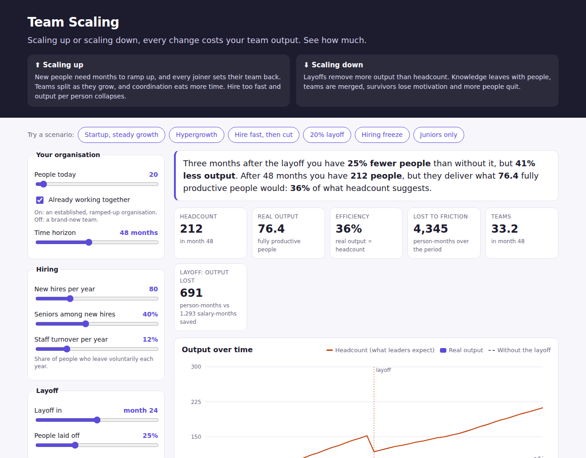

# Team Scaling

**Scaling up or scaling down, every change costs your team output.** A simulator that shows what hiring sprees, layoffs and reorgs really do to what a product organisation delivers.

Leaders often plan as if 50 people produce 50 people's worth of work. In reality, new hires need months to ramp up, teams need time to gel, every joiner or leaver sets a team back, and big organisations spend more and more time coordinating. This tool makes that gap visible, for HR, founders, engineering leaders, or anyone who has to argue that "just hire more" or "just cut 20%" is not free.



## Use it

Open the site, pick a scenario (hypergrowth, 20% layoff, hiring freeze, juniors only, ...) or move the sliders. Every scenario has its own link, so you can share the exact setup you are looking at.

## Run locally

```bash
npm install
npm run dev     # local dev server
npm test        # model tests
npm run build   # static site in dist/
npm run deploy  # build and publish to the gh-pages branch
```

The site is static and has no backend or tracking. It is served by GitHub Pages from the `gh-pages` branch; `npm run deploy` rebuilds and publishes it.

## The model

An agent-based model: every person and every team is simulated month by month, many times with different random seeds, and the chart shows the median and the 10-90% range.

- **People ramp up.** New hires start at 20% (junior) or 40% (senior) productivity. Seniors reach full speed in about 6 months. Juniors reach 60% in about 6 months, then grow to full speed over about 2 years. Ramp-up slows when a team has more newcomers than experienced people.
- **Teams gel, and change resets them.** Teams move through Tuckman's stages (forming, storming, norming, performing) in about 10 months. Every joiner or leaver, every split and every merge knocks a team back.
- **Bigger means more overhead.** Communication paths grow as n(n-1)/2, so a team's output peaks at around 10-12 people. Teams split when they reach the split size and merge when they shrink below the minimum. Each extra team adds coordination overhead.
- **Layoffs cost more than salaries.** Leavers take knowledge with them, survivors lose motivation for about a year, and more people leave voluntarily. Layoff scenarios are compared with the same organisation without the layoff.

Output is measured against your organisation today: an established team starts at 100%, so the model never claims to know how productive you are now, only what a change costs from there. A brand-new team starts lower because it still has to ramp up and gel.

Every assumption is a parameter under *Advanced assumptions* in the UI, and in `DEFAULTS` in [`src/model.ts`](src/model.ts). **It is a thinking tool, not a forecast.**

## Origins

This started as a NetLogo model built in 2023. It is kept unchanged in [`netlogo/`](netlogo/), together with its original documentation ([`netlogo/README.md`](netlogo/README.md)); open it with [NetLogo](https://ccl.northwestern.edu/netlogo/). [`docs/model-changes.md`](docs/model-changes.md) explains what changed in this version and why.

Theory it builds on:

- Tuckman, B. W. (1965). *Developmental sequence in small groups.*
- Ricardo, D. (1817). *On the Principles of Political Economy and Taxation* (diminishing returns).
- Brooks, F. P. (1975). *The Mythical Man-Month* (communication overhead).

## Feedback

Feedback and real-world data to calibrate the defaults are welcome. Please open an issue.

## License

Copyright © 2023-2026 K. Lechner. All rights reserved. The code is public for viewing and reference only; see [LICENSE](LICENSE). You are welcome to use the hosted simulator.
